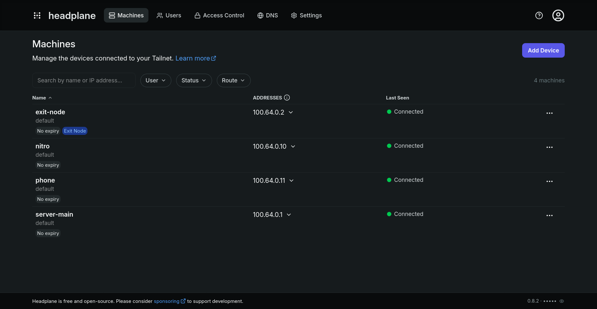

<div align="center">

# Headscale Stack

**Declarative Headscale + Headplane Docker Compose stack with an optional Caddy reverse proxy for automated HTTPS.**

<a href="https://docs.docker.com/compose/"></a>
<a href="https://github.com/juanfont/headscale"></a>
<a href="https://github.com/tale/headplane"></a>
<a href="https://caddyserver.com/"></a>
<a href="LICENSE"></a>

<br>

[Features](#features) • [Architecture](#architecture) • [Quick Start](#quick-start) • [Connecting Devices](#connecting-devices) • [Reverse Proxy](#reverse-proxy-options)



</div>

---

## Features

- ⚙️ **100% Declarative & GitOps-Ready**: No host-level bash scripts or runtime string manipulations. The entire stack is configured via a single `.env` file.
- 🖥️ **Modern Web Interface**: Bundled with [Headplane](https://github.com/tale/headplane) for visual node management, ACL configuration, and MagicDNS controls.
- 🔒 **Zero-Config Automatic TLS**: Built-in [Caddy](https://caddyserver.com/) reverse proxy provisions and renews Let's Encrypt / ZeroSSL certificates automatically.
- 🌐 **Flexible Ingress**: Run the built-in Caddy proxy (`COMPOSE_PROFILES=caddy`) or seamlessly connect your existing Nginx Proxy Manager, Traefik, or host Nginx.
- 🛡️ **Container Health & Order**: Headscale health checks (`headscale health`) ensure Headplane boots strictly when the control plane and database are ready.
- 📦 **Safe Data Persistence**: SQLite databases, TLS certificates, and session data live in isolated Docker Named Volumes—no host permission issues (`UID/GID`).
- ⚡ **Tailscale Compliant**: Implements real client IP forwarding (`True-Client-IP`), WebSocket streaming, and mobile captive portal detection (`/generate_204`).

## Architecture

```text
                     ┌────────────────────────────────────────┐
                     │          Internet / Clients            │
                     └───────────────────┬────────────────────┘
                                         │
                   443/tcp (HTTPS)       │        3478/udp (STUN)
             ┌───────────────────────────┴───────────────────────────────┐
             ▼                                                           │
   ┌───────────────────┐                                                 │
   │   Reverse Proxy   │                                                 │
   │   (Caddy / NPM)   │                                                 │
   └─────────┬─────────┘                                                 │
             │                                                           │
   ┌─────────┴──────────────────────┐                                    │
   │ /admin*                        │ /*                                 │
   ▼                                ▼                                    ▼
┌──────────────────────┐   ┌────────────────────────────────────────────────┐
│      Headplane       │──>│                   Headscale                    │
│       (Web UI)       │   │          (Control Plane / Hub / STUN)          │
└──────────┬───────────┘   └───────────────────────┬────────────────────────┘
           ▼                                       ▼
    [headplane-data]                        [headscale-data]
```

## Quick Start

### 1. Clone the repository
```bash
git clone https://github.com/mikhailde/headscale-stack.git
cd headscale-stack
```

### 2. Prepare environment variables
```bash
cp .env.example .env
```
Edit `.env` and configure your settings:
```ini
DOMAIN=headscale.example.com
COMPOSE_PROFILES=caddy
```

Generate a secure 32-character hex secret for Headplane:
```bash
openssl rand -hex 16
```
*(Copy the output into `HEADPLANE_COOKIE_SECRET`)*

Generate a bcrypt password hash for Caddy Basic Auth:
```bash
docker run --rm caddy:latest caddy hash-password --plaintext "your_secure_password"
```
*(Paste into `ADMIN_PASSWORD_HASH` in `.env`. Note: escape each `$` as `$$`, e.g. `$$2a$$14$$...`)*

> [!WARNING]
> **Cloudflare DNS Users**: If using Cloudflare DNS, set your DNS record proxy status to **DNS-only (grey cloud)**. Cloudflare Proxy blocks Tailscale WebSocket POST requests required by the protocol.

### 3. Launch the stack
```bash
docker compose up -d
```

### 4. Create an API Key & Access the Dashboard
Generate a Headscale API key for Headplane:
```bash
docker compose exec headscale headscale apikeys create --expiration 90d
```

Open `https://<your-domain>/admin` in your browser:
1. Log in via HTTP Basic Auth using your configured `ADMIN_USER` and password.
2. Enter the generated API key into Headplane to access the dashboard.
3. Create your first user under **Users** (e.g. `default`). Clients require an existing user to register.

## Connecting Devices

### Linux / macOS / Windows
Run the following command in your terminal:
```bash
tailscale up --login-server https://<your-domain>
```

To authenticate automatically with a pre-auth key:
```bash
tailscale up --login-server https://<your-domain> --auth-key <preauth-key>
```

### iOS / Android
1. Open the official Tailscale app.
2. Open the menu → **Settings** → **Accounts** → **Use custom control server**.
3. Enter your server URL: `https://<your-domain>`.

## Reverse Proxy Options

### Option A: Built-in Caddy (Default)
Keep `COMPOSE_PROFILES=caddy` in `.env`. Caddy manages Let's Encrypt certificates, HTTP-to-HTTPS redirects, `/generate_204` responses, and basic auth out of the box.

### Option B: External Reverse Proxy (Nginx Proxy Manager, Traefik, Host Nginx)
1. In `.env`, set `COMPOSE_PROFILES=` (empty string).
2. Connect your external proxy container to the stack network:
   ```bash
   docker network connect headscale-net <your-proxy-container-name>
   ```
3. Configure your proxy rules:

| Route | Target | Protocol | Notes |
| :--- | :--- | :--- | :--- |
| `https://<domain>/admin*` | `http://headplane:3000` | HTTP | Enable WebSockets |
| `https://<domain>/*` | `http://headscale:8080` | HTTP | Enable WebSockets, pass `True-Client-IP` |

<details>
<summary>View Nginx configuration snippet</summary>

```nginx
# Pass real client IP to Headscale
proxy_set_header True-Client-IP $remote_addr;
proxy_set_header X-Real-IP $remote_addr;
proxy_set_header Upgrade $http_upgrade;
proxy_set_header Connection $http_connection;
proxy_http_version 1.1;

# Captive portal detection for mobile devices
location = /generate_204 {
    return 204;
}

# Headplane Web UI
location /admin {
    proxy_pass http://headplane:3000;
}

# Headscale VPN Control Plane
location / {
    proxy_pass http://headscale:8080;
}
```
</details>

## DERP (Relay) Configuration

Headscale allows relaying traffic when direct WireGuard P2P connections cannot be established through strict NATs:

- **Embedded DERP Server**: Controlled via `DERP_SERVER_ENABLED=true/false` in `.env`. When enabled, Headscale serves STUN on port `3478/udp`.
- **Global Tailscale DERP Map**: Configured in `config/headscale.yaml` under `derp.urls`. 
  - To run in **100% private / air-gapped mode** without sending relay traffic to Tailscale Inc servers, set:
    ```yaml
    derp:
      urls: []
    ```

<details>
<summary>Client Deployment Recipes (Exit Nodes & Server Nodes)</summary>

### 1. Tailscale Exit Node (Full VPN Gateway `0.0.0.0/0`)
Use this recipe to turn a remote VPS into an exit node for browsing the internet:

```yaml
services:
  tailscale-exit:
    image: tailscale/tailscale:stable
    container_name: tailscale-exit
    restart: unless-stopped
    devices:
      - /dev/net/tun:/dev/net/tun
    cap_add:
      - NET_ADMIN
      - NET_RAW
    sysctls:
      - net.ipv4.ip_forward=1
      - net.ipv6.conf.all.forwarding=1
    volumes:
      - tailscale-state:/var/lib/tailscale
    environment:
      - TS_AUTHKEY=replace_with_preauth_key
      - TS_HOSTNAME=exit-node
      - TS_USERSPACE=false
      - TS_STATE_DIR=/var/lib/tailscale
      - TS_ROUTES=0.0.0.0/0,::/0
      - TS_EXTRA_ARGS=--login-server=https://<your-domain> --advertise-exit-node
volumes:
  tailscale-state:
```

### 2. Tailscale Server Node (Host Network Endpoint)
Use this recipe to join any Docker host directly into your private tailnet:

```yaml
services:
  tailscale-server:
    image: tailscale/tailscale:stable
    container_name: tailscale-server
    restart: unless-stopped
    network_mode: host
    devices:
      - /dev/net/tun:/dev/net/tun
    cap_add:
      - NET_ADMIN
      - NET_RAW
    volumes:
      - tailscale-state:/var/lib/tailscale
    environment:
      - TS_AUTHKEY=replace_with_preauth_key
      - TS_HOSTNAME=server-main
      - TS_USERSPACE=false
      - TS_STATE_DIR=/var/lib/tailscale
      - TS_EXTRA_ARGS=--login-server=https://<your-domain> --reset
volumes:
  tailscale-state:
```
</details>

## Security & Maintenance

### Read-Only Configuration
`config/headscale.yaml` and `config/headplane.yaml` are mounted read-only (`:ro`). This adheres to GitOps principles: configuration changes are version-controlled in Git rather than modified ad-hoc from a web browser.

### Single Sign-On (OIDC/SSO)
If you configure Headplane with an OIDC provider (Google, GitHub, Keycloak), make sure to remove or bypass Caddy Basic Auth. Basic Auth will intercept `/admin/oidc/callback` and cause OAuth authentication flow failures.

### Backup & Restoration
All persistent state (SQLite database and encryption keys) is stored in the `/var/lib/headscale` directory.

#### Backup
Briefly stop the service to flush the SQLite WAL journal into the main database, then copy the data directory directly from the container:
```bash
docker compose stop headscale
docker compose cp headscale:/var/lib/headscale ./headscale_backup_$(date +%F_%H-%M)
docker compose start headscale
```

#### Restore
To restore from a backup directory:
```bash
docker compose stop headscale
docker compose cp ./headscale_backup_<timestamp>/. headscale:/var/lib/headscale/
docker compose start headscale
```

## Show Your Support

If this stack saved you time, please consider giving it a [⭐ Star](https://github.com/mikhailde/headscale-stack) — it helps more people discover the project!

## References & Acknowledgements

Upstream documentation, master configurations, and project inspirations:

- **[juanfont/headscale](https://github.com/juanfont/headscale)** — [Documentation](https://headscale.net/) • [Example `config.yaml`](https://github.com/juanfont/headscale/blob/main/config-example.yaml)
- **[tale/headplane](https://github.com/tale/headplane)** — [Documentation](https://headplane.net/) • [Example `config.yaml`](https://github.com/tale/headplane/blob/main/config.example.yaml)
- **[Caddy](https://caddyserver.com/)** — [Documentation](https://caddyserver.com/docs/)
- **[Tailscale](https://tailscale.com/)** — [Docker Client Guide](https://tailscale.com/kb/1282/docker)
- **[meerzulee/headscale-setup](https://github.com/meerzulee/headscale-setup)** — Original setup script that inspired this declarative stack.

## License

This project is licensed under the [MIT License](LICENSE).